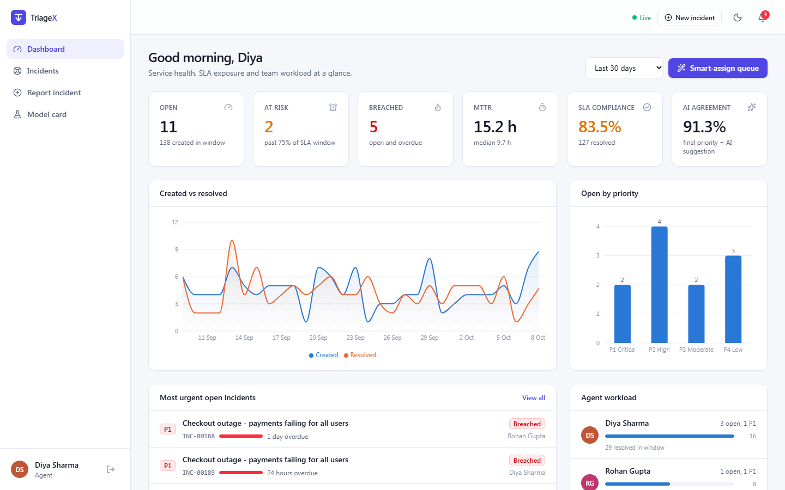
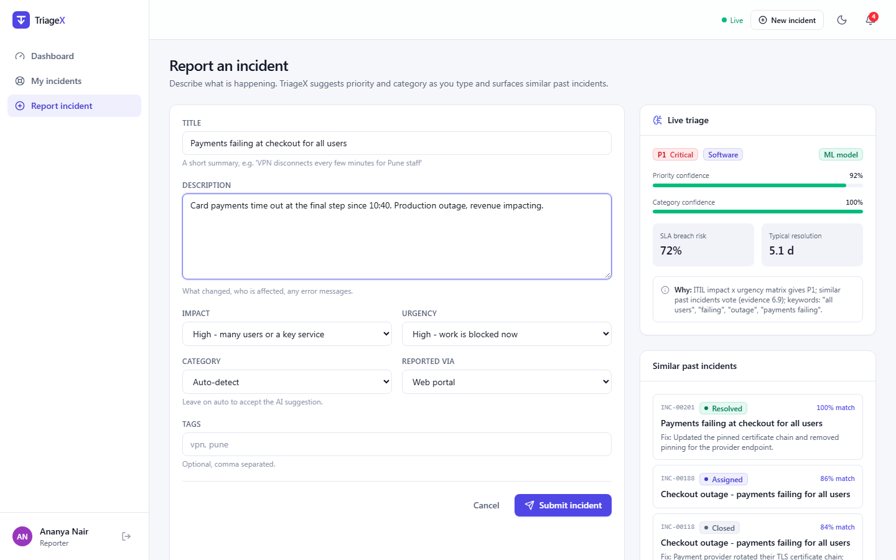
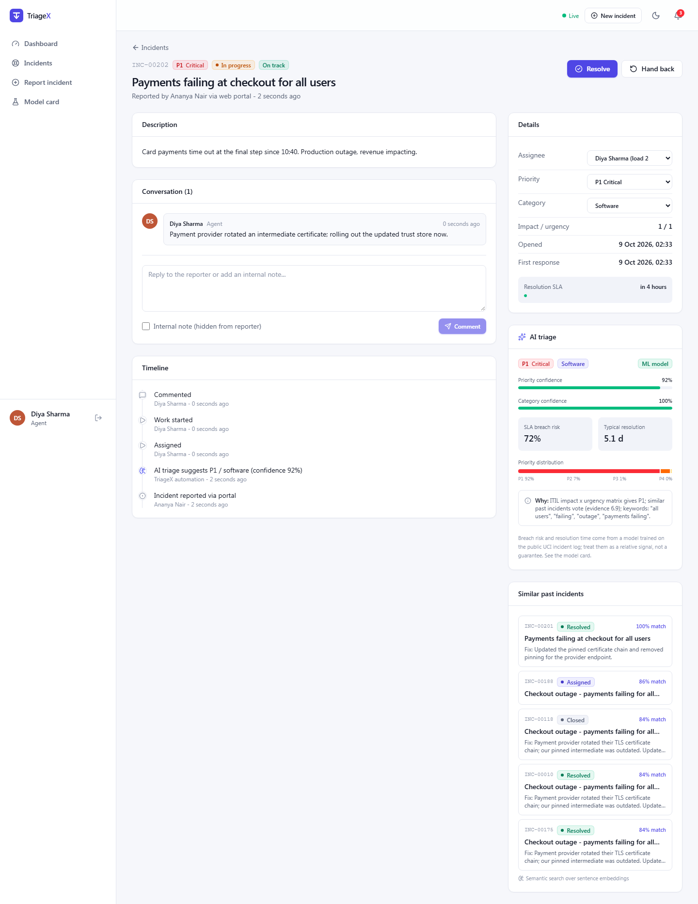
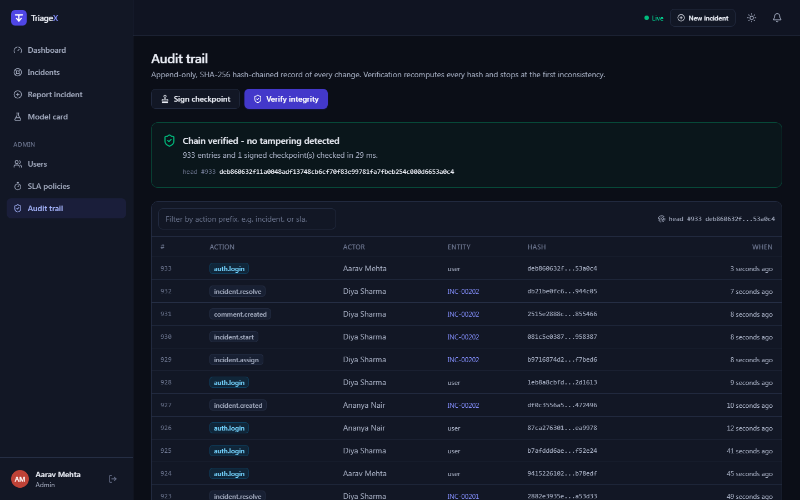
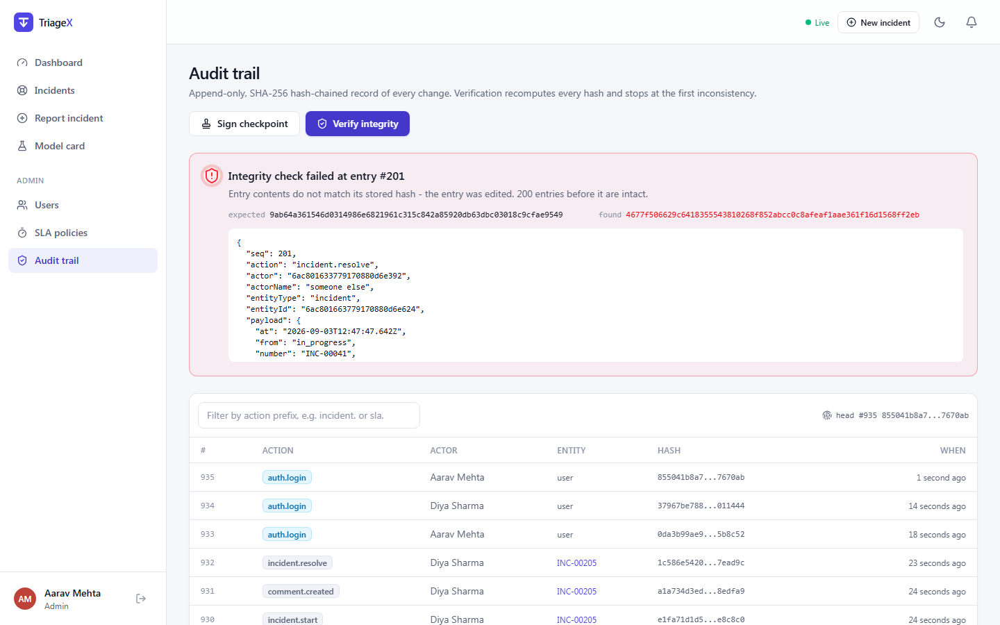
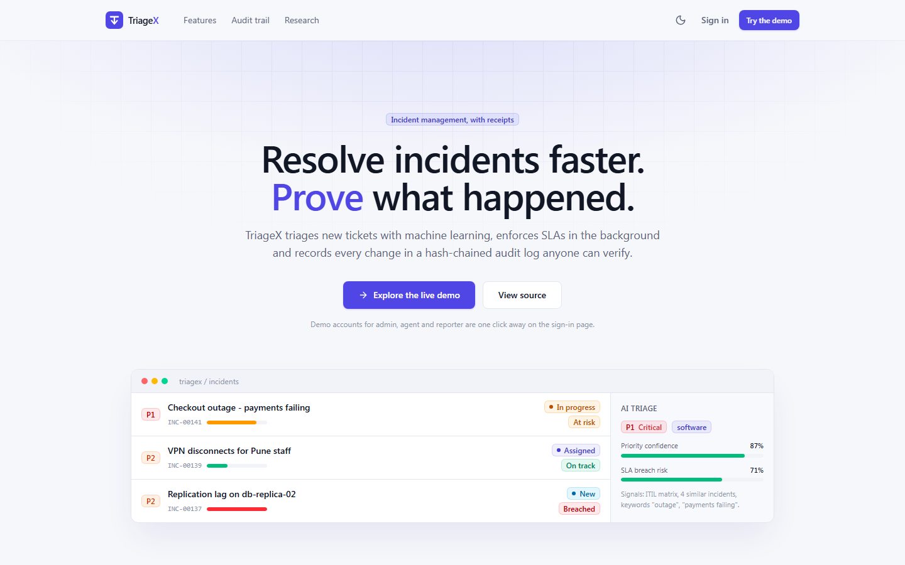
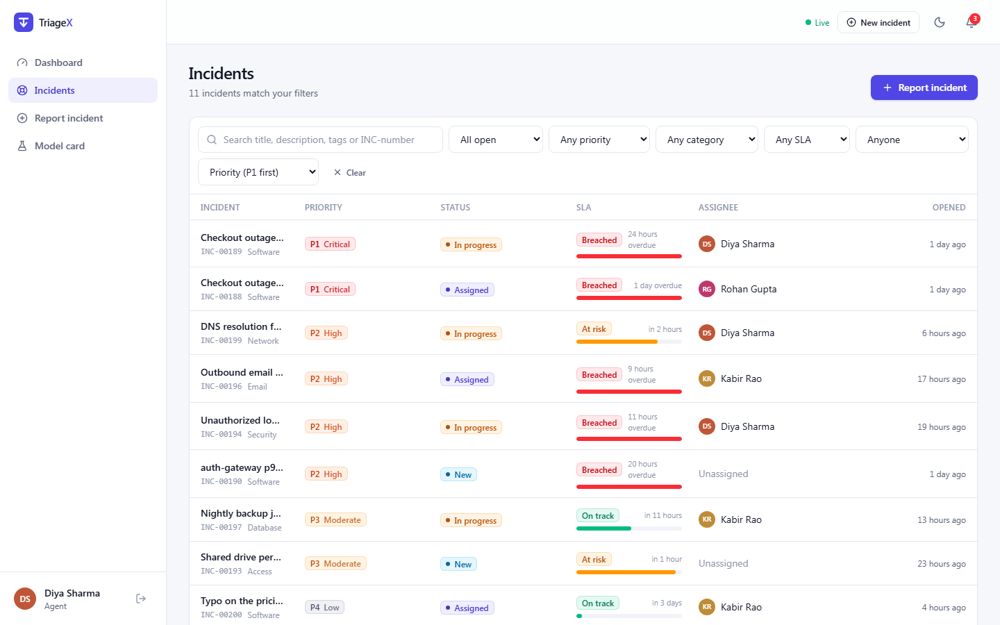
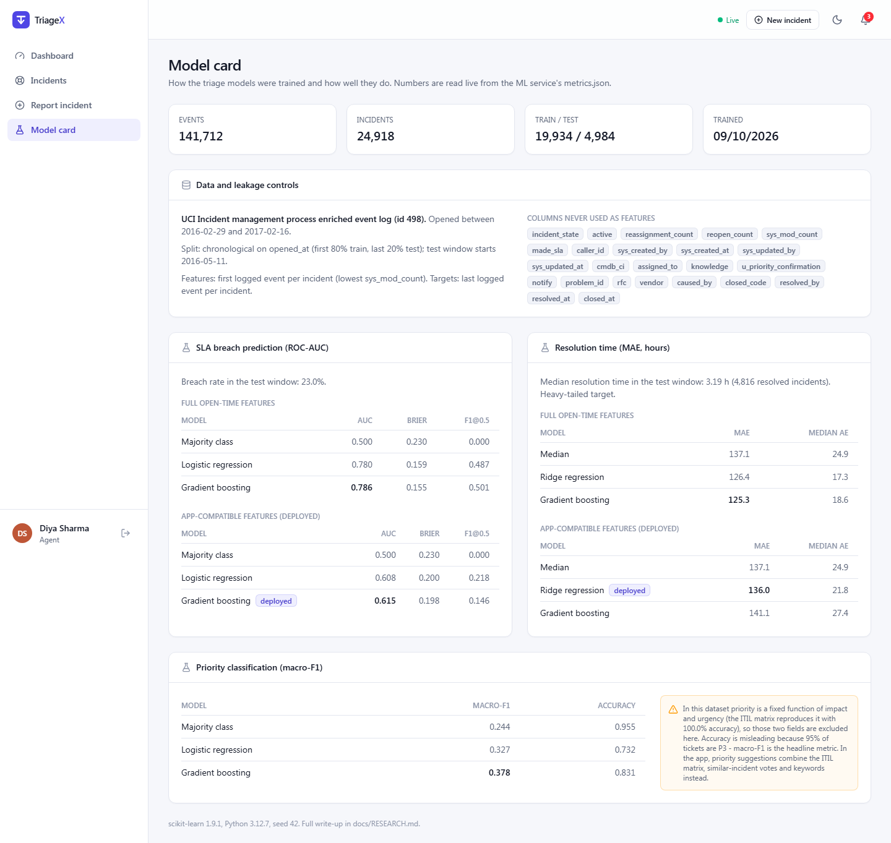
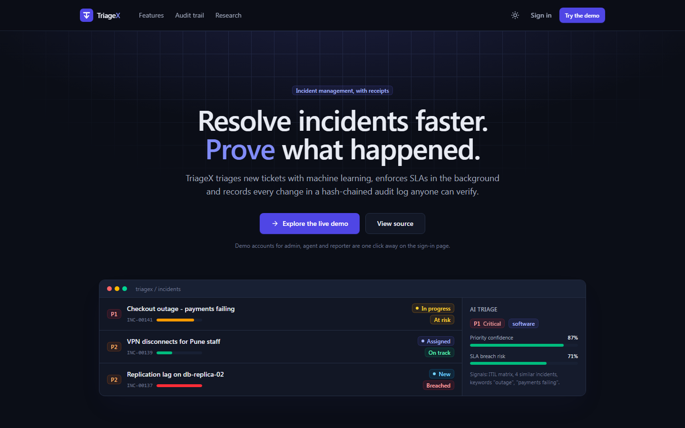
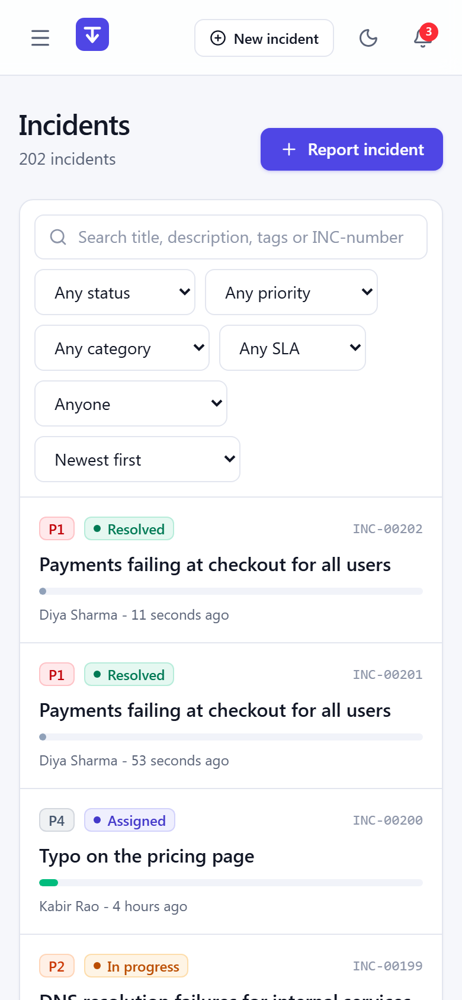

# TriageX

**AI-assisted incident management with SLA automation and a tamper-evident audit trail.**

TriageX is a full-stack incident desk. Reporters describe a problem; the system suggests a
priority and category while they type, shows how similar incidents were fixed, and starts
an SLA clock. Agents work tickets through a validated lifecycle, a background scheduler
escalates anything about to breach, and every change is written to a SHA-256 hash chain
that an admin can verify with one click.

[](https://github.com/Chetanareddy18/triagex/actions/workflows/ci.yml)




| Live triage while reporting | Incident detail |
|---|---|
|  |  |

| Audit chain verified | Tampering detected (one field edited in MongoDB) |
|---|---|
|  |  |

<details>
<summary>More screenshots: landing page, incident list, model card, dark mode, mobile</summary>







</details>

## Features

| Area | What it does |
|---|---|
| **Auth and RBAC** | Register, log in, log out. Short-lived JWT access tokens (15 min, in memory) plus rotating refresh tokens in an httpOnly cookie, with **reuse detection** that revokes the whole token family. Roles: Reporter, Agent, Admin, enforced by middleware on every route and on socket rooms. Admin user management (create, change role, disable). |
| **Incident lifecycle** | `New -> Assigned -> In progress -> Resolved -> Closed`, plus un-assign, hand-back and reopen. Transitions are validated by a state machine (`422 INVALID_TRANSITION` with the allowed targets), with role rules (reporters may only confirm or reopen their own tickets). Comments, internal notes hidden from reporters, and a full event timeline. |
| **Search and lists** | Filter by status, priority, category, SLA state and assignee; sort; paginate; full-text search through a weighted MongoDB text index (title > tags > description) or direct `INC-00042` lookup. Filters live in the URL. |
| **SLA engine** | Response and resolution targets per priority, editable by admins. A `node-cron` scanner (every 30 s, guarded by a Mongo lock so only one instance runs it) marks tickets *at risk* at 75% of the window, *breached* when overdue, raises priority one level, notifies admins and the assignee, and auto-assigns unowned breaches. State changes use compare-and-set updates, so notifications are sent exactly once. |
| **AI triage** | On create (and live while typing): suggested priority with confidence, suggested category, SLA-breach risk and typical resolution time, plus the reasons behind them. Models trained on a public dataset (see [Research](#research)). If the ML service is down, the API falls back to rules and keeps working. |
| **Similar incidents** | Title + description embedded with `all-MiniLM-L6-v2` (384-d), stored in MongoDB, ranked by cosine similarity, shown with their fixes. Falls back to a stateless hashing embedder, then to MongoDB text relevance. A background job backfills missing embeddings. |
| **Tamper-evident audit log** | Every mutation appends `{seq, action, actor, entityId, payload, prevHash, hash}` with `hash = SHA-256(prevHash + canonical JSON)`. Append-only at the model layer. *Verify integrity* walks the chain and reports the first bad entry and why (edited, broken link, deleted, or contradicts a signed checkpoint). HMAC-signed checkpoints catch a full rewrite of the chain. |
| **Smart assignment** | A hand-written binary heap: incidents ordered by priority then SLA due time, agents by weighted load (P1 = 8, P2 = 4, P3 = 2, P4 = 1). The most urgent ticket goes to the least-loaded agent, who is pushed back with the new load. O((n + m) log m). |
| **Real time** | Socket.IO with JWT handshake. Rooms per user, for staff and per incident (plus a staff-only room for internal notes). Lists, dashboards, comments and the notification bell update live. |
| **Dashboard** | Open / at-risk / breached counts, MTTR and median time to resolve, SLA compliance, AI agreement rate, created-vs-resolved trend, open by priority, agent workload. |
| **Extras** | Alert ingestion endpoint with **de-duplication** (fingerprint from source + service + normalised title; repeats fold into the open incident). Postmortem drafts from the timeline: a deterministic template by default, or an LLM when `LLM_PROVIDER` and a key are set (OpenAI-compatible endpoints or Anthropic). |
| **UI** | Landing page and app shell, light and dark themes from one token set, responsive down to phone width, skeleton loading, empty and error states, toasts, error boundary. |

## Architecture

```mermaid
flowchart LR
  subgraph Browser
    UI["React 18 + Vite<br/>TanStack Query, Recharts<br/>Tailwind tokens"]
  end
  subgraph API["API server (Node 20, Express 5, TypeScript)"]
    R["REST routes<br/>Zod validation, RBAC"]
    S["Services<br/>state machine, SLA, assignment heap"]
    A["Audit chain<br/>SHA-256 + HMAC checkpoints"]
    WS["Socket.IO<br/>user / staff / incident rooms"]
    J["node-cron jobs<br/>SLA scan, embedding backfill"]
  end
  subgraph ML["ML service (FastAPI)"]
    E["/embed<br/>MiniLM or hashing"]
    T["/triage<br/>ITIL + neighbours + lexicon<br/>breach and resolution models"]
    M["/metrics<br/>metrics.json"]
  end
  DB[("MongoDB<br/>incidents, users, audit log,<br/>embeddings, notifications")]
  UCI[["UCI incident event log<br/>141,712 events"]] -. ml/train.py .-> T

  UI -- "HTTPS /api (JWT)" --> R
  UI <-->|WebSocket| WS
  R --> S --> DB
  S --> A --> DB
  S -->|"timeout + rule fallback"| E
  S -->|"timeout + rule fallback"| T
  J --> S
  S -- events --> WS
```

Request path for a new incident: validate -> embed text (ML) -> find nearest past incidents
in MongoDB -> triage (ML, with the neighbours' agent-confirmed labels) -> compute SLA due
times -> save -> append audit entry -> broadcast over Socket.IO.

## Tech stack

| Layer | Technology |
|---|---|
| Client | React 18, TypeScript, Vite, Tailwind CSS v4, React Router, TanStack Query, Recharts, socket.io-client, sonner, lucide icons |
| API | Node 20, Express 5, TypeScript (strict), MongoDB + Mongoose, Socket.IO, JWT, bcrypt, Zod, helmet, express-rate-limit, pino, node-cron |
| ML | Python 3.12, FastAPI, scikit-learn, pandas, sentence-transformers (optional) |
| Testing | Vitest + Supertest + mongodb-memory-server, pytest, Playwright (screenshots and UI flow) |
| Ops | Docker multi-stage images, docker compose, nginx, GitHub Actions, Render blueprint, Vercel config |

## Getting started

### Option A: Docker Compose (whole stack)

```bash
git clone https://github.com/Chetanareddy18/triagex.git && cd triagex
cp .env.example .env            # then replace the three CHANGE-ME secrets
docker compose up --build -d
docker compose exec server node server/dist/scripts/seed.js   # demo data
```

Open http://localhost:8080 (API on :4000). The ML image is slim by default (hashing
embeddings); build with `ML_WITH_TRANSFORMERS=true` in `.env` for semantic embeddings.

### Option B: run each service

Requirements: Node 20+, Python 3.11+, MongoDB 7+ on `localhost:27017`.

```bash
npm install                                   # installs server + client workspaces

# ML service
python -m venv ../triagex-venv && source ../triagex-venv/bin/activate   # Windows: ..\triagex-venv\Scripts\activate
pip install -r ml/requirements-dev.txt
pip install -r ml/requirements-embeddings.txt   # optional: semantic embeddings
cd ml && uvicorn triagex_ml.api:app --port 8000 && cd ..

# API (new terminal)
cp server/.env.example server/.env              # defaults work for local dev
npm run seed                                    # demo workspace
npm run dev:server                              # http://localhost:4000

# Client (new terminal)
npm run dev:client                              # http://localhost:5173 (proxies /api and /socket.io)
```

To retrain the models: `python ml/scripts/download_data.py && cd ml && python train.py`.

### Demo accounts

All use the password **`Demo@1234`**. The sign-in page has one-click buttons for the first three.

| Role | Email | Can |
|---|---|---|
| Admin | `admin@triagex.dev` | everything, plus users, SLA policies and the audit trail |
| Agent | `agent@triagex.dev` (also `kabir@`, `meera@`, `rohan@`) | work, assign and resolve any incident, internal notes |
| Reporter | `reporter@triagex.dev` (also `vikram@`, `ishita@`, `arjun@`) | report incidents and follow their own |

## API reference

All routes are under `/api`. Authenticated routes need `Authorization: Bearer <accessToken>`.
Errors share one shape: `{ "error": { "code", "message", "details?" } }`.

| Method | Path | Role | Description |
|---|---|---|---|
| POST | `/auth/register` | public | Create a reporter account; returns access token, sets refresh cookie |
| POST | `/auth/login` | public | Log in (rate limited) |
| POST | `/auth/refresh` | cookie | Rotate the refresh token, return a new access token |
| POST | `/auth/logout` | cookie | Revoke the refresh token |
| GET | `/auth/me` | any | Current user |
| GET | `/users` | admin | List / search users |
| POST | `/users` | admin | Create a user with any role |
| PATCH | `/users/:id` | admin | Change role, name, title or active flag (revokes sessions) |
| GET | `/users/agents` | staff | Agents with live weighted load |
| GET | `/incidents` | any | List; `status, priority, category, sla, assignee=me\|unassigned\|<id>, open, q, sort, page, limit`. Reporters see only their own |
| POST | `/incidents` | any | Create; runs AI triage and returns similar incidents |
| POST | `/incidents/triage-preview` | any | Triage + similar incidents without saving |
| GET | `/incidents/:id` | owner / staff | Detail by id or `INC-number`, with allowed transitions |
| PATCH | `/incidents/:id` | staff (reporter: own new ticket wording) | Update fields; priority change recomputes SLA |
| POST | `/incidents/:id/transition` | role rules | `{ to, resolutionSummary?, note? }` |
| POST | `/incidents/:id/assign` | staff | `{ assigneeId }` or `{ auto: true }` |
| POST | `/incidents/auto-assign` | staff | Smart-assign the whole unassigned queue |
| POST | `/incidents/:id/accept-ai` | staff | Apply the AI priority and category |
| GET | `/incidents/:id/similar` | owner / staff | Nearest past incidents |
| GET, POST | `/incidents/:id/comments` | owner / staff | Comments (`internal` notes are staff-only) |
| POST | `/incidents/:id/postmortem` | staff | Draft a postmortem for a resolved incident |
| GET | `/dashboard/summary?days=30` | any | Metrics (scoped to own tickets for reporters) |
| GET, PUT | `/sla/policies` | any / admin | Read or update SLA targets |
| POST | `/sla/scan` | staff | Run the SLA scanner now |
| GET | `/audit` | admin | Paged audit entries (`entityId`, `action` prefix) |
| GET | `/audit/verify` | admin | Verify the chain; returns the first invalid entry if any |
| GET, POST | `/audit/checkpoints` | admin | List / sign a checkpoint of the chain head |
| GET | `/notifications` | any | Latest notifications and unread count |
| POST | `/notifications/:id/read`, `/notifications/read-all` | any | Mark read |
| POST | `/alerts/ingest` | `x-alert-key` or staff | Ingest a monitoring alert with de-duplication |
| GET | `/ml/health`, `/ml/metrics` | any | ML service status and research metrics |
| GET | `/health` | public | Liveness: Mongo and ML status |

Socket.IO (`/socket.io`, `auth: { token }`): server events `incident:created`, `incident:updated`,
`comment:created`, `notification:new`; client events `incident:subscribe`, `incident:unsubscribe`.

## Research

The triage models are trained on the public **UCI "Incident management process enriched event
log"** (141,712 events, 24,918 incidents). Features come only from each incident's first logged
event, 24 post-open columns are excluded, the split is chronological (80/20), and the deployed
model is chosen on a validation slice of the training window. Test-window results:

| Task | Metric | Baseline | Logistic / ridge | Gradient boosting |
|---|---|---:|---:|---:|
| Priority (impact and urgency excluded) | macro-F1 | 0.244 | 0.327 | **0.378** |
| SLA breach, full open-time features | ROC-AUC | 0.500 | 0.780 | **0.786** |
| SLA breach, app-compatible features (deployed) | ROC-AUC | 0.500 | 0.608 | **0.615** |
| Resolution time, full features | MAE (hours) | 137.1 | 126.4 | **125.3** |
| Resolution time, app-compatible (deployed: ridge) | MAE (hours) | 137.1 | **136.0** | 141.1 |

Honest reading: breach risk is learnable from open-time data (AUC 0.79), but most of that
signal sits in anonymised category and group ids that TriageX cannot map, so the deployed model
is weaker (AUC 0.62); resolution time is barely predictable. In this dataset priority is exactly
the ITIL impact x urgency matrix (100% lookup accuracy), which is why the app's priority
suggestion combines that matrix with similar-incident votes and keywords rather than the
research priority model. Full method, leakage controls and limitations (distribution shift,
censoring, timezone) are in **[docs/RESEARCH.md](docs/RESEARCH.md)**; the in-app model card reads
the same `metrics.json`.

## Testing and quality

```bash
npm test                     # server: 65 Vitest + Supertest tests on an in-memory MongoDB
npm run lint && npm run typecheck
npm run build
cd ml && pytest -q           # ML: 24 tests (features, leakage rules, triage, API)
```

The server suite covers the heap and assignment planner, every state-machine rule, SLA
evaluation and the scanner (at-risk, breach, escalation, idempotency), auth (refresh rotation and
reuse detection), RBAC boundaries, the incident lifecycle end to end, alert de-dup, dashboard
aggregates, Socket.IO delivery and room isolation, and **audit tampering**: edited payloads,
re-hashed entries, deleted entries and a fully rewritten chain are each detected at the right
sequence number. CI runs all of it plus the client build on every push.

## Deployment

The repository is deploy-ready but not deployed. What is needed:

| Piece | Where | Steps |
|---|---|---|
| MongoDB | MongoDB Atlas (free M0) | Create a cluster, copy the connection string |
| API + ML | Render, from `render.yaml` | New Blueprint -> this repo. Set `MONGO_URI`, `CLIENT_ORIGIN` (the Vercel URL) and `ML_URL` (the ML service URL). JWT and audit secrets are generated |
| Client | Vercel, root directory `client` | Edit the API URL in `client/vercel.json` rewrites; set `VITE_SOCKET_URL` to the Render API URL (WebSockets do not pass through Vercel rewrites) |
| Seed | Render shell | `node server/dist/scripts/seed.js` |

The free Render plan sleeps, so the first request after idle can take ~30 s; the API's ML timeout
is raised to 6 s there and triage falls back to rules if the ML service is still waking.

## Project structure

```
triagex/
  client/            React app (pages, components, contexts, API client)
  server/
    src/
      lib/           heap, state machine, canonical JSON + hashing, domain constants
      models/        Mongoose schemas (Incident, User, AuditLog, ...)
      services/      incidents, SLA, assignment, audit chain, ML client, notifications, LLM
      routes/        Express routers
      sockets/       Socket.IO auth and rooms
      jobs/          SLA scanner and embedding backfill
      scripts/       seed
    tests/           unit + API tests
  ml/
    triagex_ml/      features, embeddings, triage logic, FastAPI app
    train.py         training + evaluation -> models/metrics.json
    scripts/         dataset download
    tests/
  docs/              RESEARCH.md, screenshots
```

## Roadmap

- Anchor the audit chain head externally (for example, publish signed checkpoints on-chain or to a transparency log) so even a key holder cannot rewrite history unnoticed
- Atlas Vector Search instead of in-process cosine ranking for large incident volumes
- Learn a text priority model from TriageX's own agent-confirmed tickets once enough real data exists, and report its accuracy on the model card
- Business-hours SLA calendars and pausing the clock while waiting on the reporter
- Email / Slack notification channels and on-call schedules
- Multi-tenant workspaces

## License

MIT, see [LICENSE](LICENSE). Dataset: UCI Machine Learning Repository, CC BY 4.0.

Built by **Palla Chetana Reddy**.
